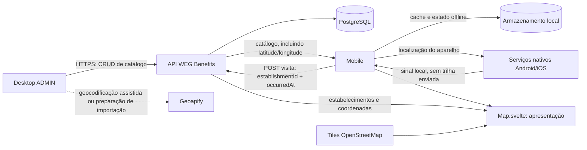

# Relatório de integração entre WEG Benefits, Mobile e localização

**Data da análise:** 2026-10-26
**Estado:** relatório técnico e proposta; não implementa integração com Geoapify nem altera o contrato da API.
**Para levar a outra máquina:** este documento reúne o contexto funcional e técnico necessário para retomar o trabalho sem esta conversa. As referências de API ativas são `../AGENTS.md`, `../README.md`, `api-contract.md` e `http-api.md`; os documentos herdados listados no índice podem conter decisões antigas.

## 1. Recomendação

**Geoapify é adequada e a recomendação é usá-la para geocodificação de endereços do catálogo.** A API converte um endereço em coordenadas, aceita busca textual ou campos separados, permite limitar a busca ao Brasil e retorna níveis de confiança que ajudam a revisar se o ponto corresponde ao estabelecimento. O plano gratuito informa 3.000 créditos por dia, sem cartão, e pode ser usado em produção dentro dos limites e com as atribuições exigidas. Uma requisição simples de geocodificação custa normalmente um crédito. [Documentação de geocodificação](https://apidocs.geoapify.com/docs/geocoding/forward-geocoding/), [preços e uso gratuito](https://www.geoapify.com/pricing/)

Para o escopo e a infraestrutura atuais, a menor integração segura é:

1. Usar Geoapify fora do fluxo do colaborador para encontrar coordenadas faltantes de estabelecimentos, conferir cada resultado e gravar `latitude`/`longitude` no JSON de importação ou no cadastro administrativo.
2. Continuar usando os tiles OpenStreetMap e Leaflet já descritos pelo Mobile. Geoapify não é necessária para desenhar o mapa.
3. Continuar obtendo a localização atual no próprio Mobile, por meio das APIs nativas Android/iOS. Não enviar coordenadas contínuas do colaborador à Geoapify nem à API WEG.
4. Depois de uma visita confirmada pelo cliente, enviar à API WEG somente o UUID do estabelecimento e o horário UTC do evento. A API atual não recebe latitude/longitude do colaborador.

Isso evita colocar uma chave Geoapify no aplicativo, onde ela poderia ser extraída, evita chamadas externas a cada abertura do mapa e permite manter o mapa e a lista de estabelecimentos em cache para uso offline. A Geoapify permite armazenar resultados, mas exige manter as atribuições às fontes de dados; no plano gratuito também exige um link de atribuição Geoapify próximo das informações fornecidas pelo serviço. [Termos de Geoapify](https://www.geoapify.com/terms-and-conditions/), [regras de atribuição e armazenamento](https://www.geoapify.com/geocoding-api/)

**Não recomendo trocar agora o provedor de tiles, adicionar PostGIS, criar uma API de geocodificação no backend ou transformar a Geoapify em dependência obrigatória do Mobile.** Nenhuma dessas mudanças é necessária para preencher coordenadas, e cada uma ampliaria o escopo ou exigiria decisão e trabalho adicionais.

## 2. O que o projeto já tem

### Backend

- API Java 21 / Spring Boot 4.1.1, Maven, monólito modular. PostgreSQL é a fonte persistente; Flyway controla migrações.
- Clientes Mobile e desktop devem acessar dados exclusivamente pela API. O Mobile não administra o catálogo.
- Módulos existentes: `identity`, `catalog`, `engagement`, `common` e `config`.
- O acesso autenticado usa sessão persistida no PostgreSQL e cookie `HttpOnly`; sessão sem expiração automática e cookie persistente até logout, conforme decisão do projeto. A URL de demonstração registrada é `https://weg-benefits-api.onrender.com`; localmente a porta padrão é `8081`.
- O contrato atual não tem integração com Geoapify, geocodificação, busca de endereço ou cálculo de rota no backend.
- A fundação CORS aceita origens configuradas em `CORS_ALLOWED_ORIGINS`, com credenciais e sem wildcard. CORS aplica-se a chamadas feitas por navegador/WebView; clientes nativos não usam CORS do navegador.

### Catálogo e coordenadas

- `Establishment` armazena `latitude` e `longitude` obrigatórias, além de CEP, número, rua, bairro, cidade e sigla UF. As coordenadas precisam estar nos intervalos latitude `-90..90` e longitude `-180..180`; a coluna numérica guarda seis casas decimais.
- A resposta pública de estabelecimento inclui suas coordenadas. O Mobile pode alimentar pins diretamente com o catálogo da API.
- A API também tem consultas paginadas de estabelecimentos e filtros por texto, categoria e serviço. A consulta pública normal omite registros inativos.
- Não há horário de funcionamento no modelo; a equipe decidiu deixá-lo fora desta versão.
- A entidade `Establishment` e suas coordenadas dizem respeito a locais públicos do catálogo, não à localização pessoal do colaborador.

### Mobile, conforme descrição fornecida pela equipe

O repositório Mobile não está incluído neste workspace; esta parte reflete a descrição compartilhada pelo usuário e deve ser conferida com o código Mobile na outra máquina.

- `src/components/Map.svelte` apresenta tiles, pins, indicador da localização recebida, viewport e rota recebida. Recebe propriedades como `benefits`, `userLocation`, `routeCoordinates` e `onBenefitSelect`.
- O componente do mapa não deve pedir localização, chamar APIs externas, ler o cache, escolher benefícios ou calcular rotas. Essas tarefas ficam fora da apresentação.
- `src/services/geolocationService.ts` é a fronteira planejada para a localização. `src/services/routingService.ts` é a fronteira planejada para rotas. Os dados fictícios estão em `src/services/benefitsService.ts`.
- Leaflet/OpenStreetMap desenha o mapa. A integração de rota OSRM descrita para o protótipo é demonstrativa e precisa ser avaliada/configurada separadamente antes de uso real.

## 3. Divisão proposta entre componentes



**Responsabilidades:**

| Responsável | Faz | Não faz |
|---|---|---|
| API WEG | Autentica, valida e persiste catálogo, favoritos e eventos finais de visita; deriva o usuário da sessão | Não rastreia GPS, não pede permissão do aparelho e não calcula a posição do Mobile |
| Geoapify | Ajuda a converter endereço de estabelecimento em coordenadas; pode fornecer rota se a equipe optar por isso depois | Não é o banco nem a fonte de verdade do catálogo WEG |
| Mobile nativo | Pede permissão, obtém posição, avalia proximidade/permanência, mantém cache e fila offline | Não conecta diretamente ao PostgreSQL |
| `Map.svelte` | Renderiza dados que a tela fornece e notifica seleção de pin | Não busca dados, não calcula rota e não decide se houve visita |
| PostgreSQL | Guarda dados do servidor, incluindo coordenadas fixas de estabelecimentos | Não guarda histórico contínuo de localização do colaborador |

## 4. Geoapify: avaliação e uso correto

### Geocodificação — encaixa no problema

A API Forward Geocoding transforma um endereço em candidatos de localização. Pode receber endereço livre ou campos estruturados, como rua, número, CEP, cidade e país. Para dados brasileiros, enviar `country=Brazil` ou restringir a `countrycode:br`, informar os componentes conhecidos e solicitar poucos resultados (`limit=3`, por exemplo). O resultado pode conter confiança do endereço, rua, cidade e prédio. Coordenadas de GeoJSON usam ordem `[longitude, latitude]`; os campos JSON `lat` e `lon` devem ser mapeados conscientemente para os campos do WEG (`latitude` e `longitude`). [Referência e exemplos oficiais](https://apidocs.geoapify.com/docs/geocoding/forward-geocoding/)

**Fluxo manual recomendado para a carga atual:**

1. Corrigir e completar o endereço antes de geocodificar. Não tratar coordenada calculada somente pelo CEP ou centro da cidade como ponto exato da loja.
2. Consultar Geoapify com rua, número, bairro, CEP, cidade, estado e país Brasil, quando disponíveis.
3. Exibir/revisar os candidatos. Confirmar nome da rua, número, cidade/UF e nível de confiança. Em ponto ambíguo ou confiança baixa, pedir confirmação humana e posicionar o pin no endereço correto.
4. Guardar no arquivo de importação/cadastro apenas as coordenadas aprovadas, com seis casas decimais suficientes para o banco atual.
5. Cadastrar via endpoint administrativo atual; a API WEG armazena as coordenadas resultantes e serve-as aos clientes.
6. Manter atribuição exigida no local apropriado. Se a UI apresentar informação derivada do serviço Geoapify no plano gratuito, deve conter o follow-link exigido; dados de OpenStreetMap precisam de `© OpenStreetMap contributors` quando aplicável. Verificar as atribuições específicas do produto efetivamente usado antes de publicar.

No trabalho de análise dos JSONs fornecidos anteriormente, vários estabelecimentos estavam sem coordenadas. Esse levantamento também apontou campos de endereço obrigatórios ausentes em alguns registros. Geocodificação não corrige endereço incompleto: completar primeiro número/CEP/bairro e mapear IDs antigos de categoria/benefício para UUIDs da API.

### Chave e segurança

- Criar chave de API no projeto Geoapify e restringi-la às APIs necessárias (começar apenas com Geocoding). Aplicar limites de origem/referrer/IP quando compatíveis com o local de uso; a documentação permite configurar essas restrições.
- Para uma preparação local de JSON, usar a chave em ferramenta/ambiente privado e removê-la de arquivos compartilhados, histórico de shell, screenshots, JSON e Git. Não colocar a chave em `Map.svelte`, no bundle do Mobile, em exemplo público ou no repositório.
- Para uma futura tela administrativa online, o desenho preferível é o desktop chamar um endpoint administrativo WEG; o backend chama Geoapify com chave em segredo de ambiente, impõe rate limit e devolve apenas candidatos mínimos. Isso ainda não existe e requer aprovação de contrato, proteção de uso/custo e política de auditoria. Alternativa de chamada direta pelo navegador só deve ser adotada com chave específica restrita a origens e aceitação explícita de que chave cliente não é secreta.
- Não mandar a localização do colaborador para Geoapify por conveniência. A localização do usuário é processada no dispositivo; apenas uma feature aprovada de rota pode eventualmente enviar origem/destino a um provedor, com comunicação clara e sem persistir a posição.

### Custo e disponibilidade

A tabela atual informa Free com 3.000 créditos por dia, até 5 requisições por segundo, sem cartão; Geocoding é geralmente um crédito por requisição. A documentação informa que o plano gratuito pode ser usado em produção se os limites e atribuições forem respeitados. A franquia é compartilhada entre APIs Geoapify, então tiles, rotas e busca também podem consumir créditos se forem adicionados. Limites e termos podem mudar; rever a página oficial antes do deploy. [Pricing](https://www.geoapify.com/pricing/)

Geoapify é um serviço externo e pode falhar, mudar limites ou não encontrar o endereço. Geocodificação serve para preparar/revisar cadastro, não deve bloquear a consulta do catálogo nem o mapa em uso normal: após aprovação, as coordenadas ficam persistidas no WEG.

### Geoapify não substitui o mapa/tiles

O mapa atual usa Leaflet com tiles OpenStreetMap. Geocoding devolve resultados, não substitui por si só a camada cartográfica do Leaflet. Geoapify oferece tiles e Routing API, mas mudar tiles implica chave, consumo, configuração offline/cache e atribuição; mudar roteamento também implica integração, UX e testes próprios. Deixar as duas integrações separadas permite avaliar depois sem mexer no dado de catálogo.

## 5. Localização no Mobile e visitas

### Permissão e localização em primeiro plano

1. Pedir permissão contextual somente quando a pessoa abrir o mapa ou ativar o recurso de visitas próximas; explicar o benefício e o uso.
2. Começar com localização em primeiro plano para centralizar o mapa. Tratar permissão negada, serviços de localização desligados, precisão reduzida, posição indisponível e timeout; o catálogo continua navegável sem localização.
3. A posição atual é transitória e fica no estado local do Mobile. Não precisa virar entidade, coluna ou requisição periódica ao backend.
4. Mostrar claramente quando o Mobile estiver usando localização em segundo plano e oferecer controles para parar/desativar o recurso.

### Três minutos no estabelecimento

Decisão aprovada: o Mobile cria uma visita depois de detectar permanência de três minutos no estabelecimento. A API recebe somente o evento final. Ela não verifica de forma independente se o aparelho esteve ali, pois não recebe amostras de posição; valida a sessão, estabelecimento, horário e idempotência.

Recomendação de algoritmo do cliente, a ajustar/testar no dispositivo real:

1. Obter da API o catálogo ativo com coordenadas e manter cache sincronizado.
2. Usar geofence/eventos de entrada e saída do sistema operacional como indício de proximidade, não como prova de posição exata.
3. Após entrada, manter estado local de permanência e timer monotônico de 3 minutos. Exigir sinais suficientes de precisão e consistência; cancelar/reiniciar se saída ou evidência de afastamento ultrapassar o limite configurado pelo Mobile. O raio, a precisão mínima, o comportamento quando não chegam atualizações e a tolerância de movimento continuam decisões de implementação do Mobile, ainda não definidos no contrato do backend.
4. Persistir localmente um evento final com `establishmentId` e `occurredAt` UTC, e criar uma chave idempotente estável para a fila.
5. Enviar quando houver rede e sessão válida. Não incluir coordenadas do aparelho, trilha, precisão GPS ou `userId`.

**Limite importante:** “3 minutos” é regra do produto, mas geofencing em background não é um cronômetro de alta precisão garantido. Android limita atualizações de localização em segundo plano e eventos podem atrasar; a documentação alerta que a resposta do geofence pode ser da ordem de minutos. iOS pode suspender apps e entregar eventos depois, com monitoramento de regiões gerenciado pelo sistema. Portanto, trate os três minutos como limiar do cliente, explique a tolerância na UX e não prometa registro no segundo exato. Testar com app em primeiro plano, em background, tela bloqueada, economia de bateria, rede indisponível, permissão aproximada/precisa e após reinicialização. [Android: geofencing](https://developer.android.com/develop/sensors-and-location/location/geofencing), [Android: bateria e background](https://developer.android.com/develop/sensors-and-location/location/battery), [Apple: regiões geográficas](https://developer.apple.com/documentation/corelocation/monitoring-the-user-s-proximity-to-geographic-regions), [Apple: atualizações em background](https://developer.apple.com/documentation/corelocation/handling-location-updates-in-the-background)

O Mobile precisa implementar também re-registro dos geofences após eventos de ciclo de vida do aparelho conforme cada plataforma. Os limites de quantidade, permissões e callbacks variam por sistema. Android documenta limite de 100 geofences ativos por app/usuário; o registro deve ser priorizado para as lojas relevantes à área de uso, não para um catálogo ilimitado. [Android geofencing](https://developer.android.com/develop/sensors-and-location/location/geofencing)

### Privacidade

- Não criar endpoint de trilha GPS e não persistir coordenadas do colaborador.
- Não enviar localização a cada atualização, ao abrir o mapa ou para “confirmar” visita.
- Histórico de visita guarda apenas estabelecimento, horário declarado do evento e horário de recebimento.
- Pedir e explicar permissão de segundo plano apenas se o recurso de visita automática depender dela. Se o usuário negar, manter alternativas de uso do mapa; a visita automática poderá não funcionar.
- Definir no Mobile retenção do estado transitório e limpeza de buffers locais. A fila offline aprovada pode durar até reconexão, mas deve estar vinculada à conta que a criou e nunca migrar para outra conta.

## 6. Contrato atual API ↔ Mobile

### Endereços base

| Ambiente | Base URL | Observação |
|---|---|---|
| Local | `http://localhost:8081` | API e PostgreSQL local; use host/emulador correto no aparelho, pois `localhost` no aparelho aponta para o próprio aparelho |
| Demonstração | `https://weg-benefits-api.onrender.com` | Pode dormir no plano gratuito; primeira resposta após inatividade pode demorar |

Em dispositivo físico, configurar a URL local para um endereço acessível pela rede do computador/emulador, sem hardcodar em componentes. O backend local pode ser servido em HTTP para desenvolvimento; para produção usar HTTPS.

### Login e sessão

1. `POST /v1/auth/login` com JSON `{ "login": "username-ou-email", "password": "..." }`.
2. Guardar o cookie de sessão de forma segura no mecanismo compatível com o runtime Mobile e enviar o mesmo cookie nas próximas chamadas.
3. `GET /v1/me` verifica o perfil/sessão; `POST /v1/auth/logout` encerra a sessão.
4. No cliente web, requisições cross-origin com cookie precisam usar `credentials: "include"`, CORS deve listar a origem exata e os atributos de cookie precisam ser compatíveis com o contexto. A configuração atual do servidor usa `HttpOnly`, `SameSite=Lax`, `Secure` configurável e origens CORS explícitas. Se o Mobile for WebView/Capacitor/Ionic, verificar origem e jar de cookies do WebView/cliente HTTP; não presumir que `fetch` e o plugin nativo compartilham cookies. Se isso não funcionar, resolver com ajuste explícito de integração/session transport antes de trocar por JWT — não há decisão para implementar JWT.
5. Nunca salvar senha em log ou arquivo. O Mobile pode armazenar a sessão conforme práticas da plataforma; logout e 401 devem limpar credenciais/sessão locais.

### Leitura de catálogo e mapa

1. Autenticar uma vez e carregar `GET /v1/categories?page=0&size=...`, `GET /v1/services?page=0&size=...` e páginas de `GET /v1/establishments?page=0&size=...`.
2. Se precisar filtrar, usar parâmetros existentes `query`, `categoryId` ou `serviceId`; respeitar `totalPages` e continuar até finalizar a sincronização.
3. Guardar no cache os campos de estabelecimento necessários à lista/mapa: UUID, nome, endereço, latitude, longitude, estado ativo e informações de categoria/benefício devolvidas. Atualizar cache quando a API estiver disponível. Manter no cache o timestamp de sincronização e lidar com registro desativado removendo-o/ocultando-o na próxima sincronização.
4. Converter as coordenadas de estabelecimento para o formato esperado por Leaflet. A API fornece campos nomeados `latitude` e `longitude`; não inverter. GeoJSON da Geoapify, caso usado para rota, segue ordem `[longitude, latitude]`; adaptar explicitamente para `routeCoordinates` no formato `[latitude, longitude]` descrito para `Map.svelte`.
5. Passar benefícios, posição atual opcional e rota opcional como propriedades para `Map.svelte`. O componente não chama a API WEG nem Geoapify por conta própria.

### Favoritos e visitas

| Ação Mobile | Requisição | Notas |
|---|---|---|
| Listar favoritos | `GET /v1/me/favorites?page=0&size=20` | Paginação; conta é derivada da sessão |
| Adicionar favorito | `PUT /v1/me/favorites/{establishmentId}` | UUID; idempotente; resposta `204` |
| Remover favorito | `DELETE /v1/me/favorites/{establishmentId}` | Idempotente; resposta `204` |
| Listar visitas | `GET /v1/me/visits?page=0&size=20` | Histórico da própria conta |
| Enviar visita | `POST /v1/me/visits` | Só evento final; `201` novo e `200` para repetido/duplicado |

Exemplo de evento final:

```json
{
  "establishmentId": "UUID_DO_ESTABELECIMENTO",
  "occurredAt": "2026-10-26T15:30:00Z"
}
```

A API usa usuário da sessão. Não envie `userId`. Reenvios usam a mesma combinação de conta, estabelecimento e instante UTC; o servidor também trata evento do mesmo usuário/estabelecimento dentro de 30 minutos como duplicado. Operações offline podem aguardar sem prazo até a reconexão. Se a sessão não for aceita (`401`), não reenviar fila sob outra conta; informar a pessoa e oferecer apagar a fila local.

### Erros e suporte

- Respeitar status HTTP: `400` entrada inválida, `401` sessão ausente/revogada, `403` papel insuficiente, `404` registro não encontrado/visível e `409` conflito, conforme resposta de erro uniforme da API.
- Capturar `X-Request-Id` da resposta quando suporte/diagnóstico for necessário; não incluir token, senha nem coordenadas pessoais em telemetria.
- `GET /actuator/health` é diagnóstico operacional, não endpoint de negócio nem prova de login, e não precisa ser chamado a cada sincronização.

## 7. Esboço técnico para a outra máquina

### Preparação local da API

Na raiz do repositório Backend:

```powershell
docker compose up -d postgres
docker compose ps
.\mvnw.cmd spring-boot:run
```

O `mvnw.cmd` é o comando PowerShell usual (digite `.\mvnw.cmd spring-boot:run`). Verifique `http://localhost:8081/actuator/health`; health local `UP` não valida autenticação ou catálogo. Use Swagger em `http://localhost:8081/swagger-ui.html` ou consulte `docs/http-api.md` para rotas e payloads.

### Organização sugerida no Mobile

```text
src/
  services/
    apiClient.ts              # base URL, JSON, cookie/credentials, X-Request-Id, erros
    authService.ts            # login, sessão e logout
    catalogService.ts         # paginação e cache de catálogo
    engagementService.ts      # favoritos, visitas e fila offline
    geolocationService.ts     # adaptador da localização nativa
    routingService.ts         # só se a equipe aprovar e escolher provedor de rota
  storage/
    catalogCache.ts           # cache local do catálogo
    syncQueue.ts               # ações offline vinculadas à conta
  components/
    Map.svelte                 # apresentação; consome dados por props
```

É uma separação recomendada, não uma afirmação de que esses módulos já existam exatamente assim. Ajustar às convenções do repositório Mobile. A interface de serviços deve ser testável com dados falsos sem GPS, rede ou chave Geoapify.

### Sequência de implementação na outra máquina

1. Obter o Mobile e confirmar empacotamento/runtime (Svelte web, PWA, Capacitor ou outro), versões Android/iOS, ferramenta nativa de localização e armazenamento seguro de sessão.
2. Implementar `apiClient` configurável por ambiente; testar login, cookie, `GET /v1/me`, falha `401`, logout e CORS/origem real.
3. Implementar leitura paginada e cache do catálogo; conferir com `/v1/api-docs` e os exemplos deste repositório.
4. Conectar o `Map.svelte` a dados reais e conferir a ordem latitude/longitude, pins, categoria e fallback offline.
5. Adicionar favoritos e fila offline com isolamento por conta.
6. Implementar localização foreground; testar permissões e precisão aproximada antes do background.
7. Implementar geofences/background para cada plataforma e regra de permanência de três minutos; testar atrasos, bateria, app encerrado/reiniciado e fila sem rede. O requisito de Android/iOS não pode ser completado somente com código Svelte de apresentação.
8. Carregar evento final em `POST /v1/me/visits`; conferir duplicatas e comportamento `401`.
9. Geocodificar endereços faltantes com Geoapify em etapa de preparação/admin, confirmar resultados manualmente e atualizar dados de estabelecimento pela API.
10. Rever atribuições Geoapify/OpenStreetMap se algum produto Geoapify estiver efetivamente integrado e publicar as limitações do uso de background.

## 8. Decisões ainda necessárias para concluir integração

Não são bloqueios para o relatório ou para preparar coordenadas manualmente, mas precisam de decisão/validação antes da função correspondente ser considerada pronta:

1. **Runtime do Mobile:** é app Web/PWA, WebView/Capacitor, React Native ou outra arquitetura? Qual versão/estrutura atual do projeto na nova máquina?
2. **Permissões de localização:** o recurso de visitas automáticas exigirá localização “Sempre”/background? Qual mensagem de consentimento e alternativa se negada?
3. **Parâmetros de visita no dispositivo:** raio de entrada/saída, precisão mínima, tolerância, tratamento de atualização atrasada ou posição ruim; definir e testar sem alterar contrato do backend.
4. **Sessão em WebView/nativo:** validar como persistir e enviar o cookie atual no runtime selecionado; não introduzir JWT sem decisão.
5. **Rotas:** o MVP mostra apenas pins ou desenha rota de navegação? Se houver rotas, confirmar modo (a pé/carro), provider e política de chave/cota. OSRM do protótipo não é configuração de produção; Geoapify Routing é candidata, não selecionada.
6. **Experiência quando offline:** o mapa base atual via tiles não se torna offline automaticamente. A equipe aprovou cache de dados/ícones; ainda é preciso confirmar a estratégia/licença de cache/offline dos tiles. Não fazer download em massa dos tiles públicos `tile.openstreetmap.org` sem validar a política do servidor.
7. **Atribuição:** onde aparecerão `© OpenStreetMap contributors` e, se for usada a conta Geoapify gratuita na aplicação, `Powered by Geoapify`.
8. **Geocodificação dentro do painel:** escolher depois entre revisão offline de JSON (recomendada inicialmente) e endpoint administrativo proxy. Não há endpoint de geocoding nem tabela de auditoria de origem/confiança no modelo atual.

## 9. Estado da decisão

- **Avaliação Geoapify:** adequada para geocodificação; recomendada inicialmente para enriquecimento manual/revisado de catálogo. Provedor escolhido para produção ainda não foi aprovado explicitamente.
- **Localização em segundo plano:** propriedade do Mobile e de APIs nativas; o Backend já está definido para receber apenas eventos finais.
- **Regra confirmada:** visita após 3 minutos; sincronização offline até reconectar; sem reatribuir fila a outra conta.
- **Fora do relatório/sem implementação:** integração de código Geoapify, endpoint novo, PostGIS, mudança de tiles, roteamento de produção, alteração de contrato, deploy e migrações.

## Fontes oficiais

- Geoapify Forward Geocoding: <https://apidocs.geoapify.com/docs/geocoding/forward-geocoding/>
- Geoapify preços e limites gratuitos: <https://www.geoapify.com/pricing/>
- Geoapify termos e atribuição: <https://www.geoapify.com/terms-and-conditions/> e <https://www.geoapify.com/geocoding-api/>
- Geoapify Routing API: <https://apidocs.geoapify.com/docs/routing/>
- Android geofencing: <https://developer.android.com/develop/sensors-and-location/location/geofencing>
- Android background e bateria: <https://developer.android.com/develop/sensors-and-location/location/battery>
- Apple monitoring de regiões: <https://developer.apple.com/documentation/corelocation/monitoring-the-user-s-proximity-to-geographic-regions>
- Apple localização em background: <https://developer.apple.com/documentation/corelocation/handling-location-updates-in-the-background>
